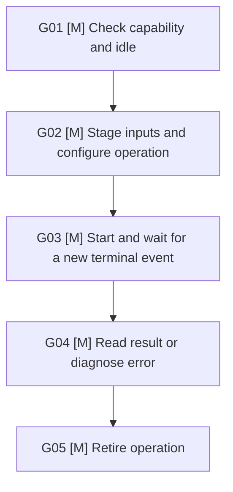

# Digital Signature IP software sequences

**Worked example.** Use this example to structure section 11.2 and trace software actions to their sources. The IP integration and verification gaps listed below remain open. The target is the Digital Signature IP revision described in the hardware design specification (HDS) dated 2026-11-24. Sources are the IP HDS sections 4, 6, 8, 10, 11, 12, 14.2.2, 15 and 20, the Control and Status Register (CSR) definition input `dsig_regs.json`, and the existing verification evidence in `ENGINES.md`. Values below are field values, not whole register words. Confirm the review items at the end before adopting these procedures as a driver contract.

M denotes a mandatory step on the shown path. O denotes a conditional step. Advanced Peripheral Bus version 4 (APB4) control writes use full 32-bit accesses. Advanced eXtensible Interface version 4 (AXI4) accesses the data buffer. A system-on-chip (SoC) controller owns Direct Memory Access (DMA) programming and platform interrupt routing. No platform register addresses are assumed.

### 11.2 Software sequences

#### 11.2.1 Common operation flow

**Scope and prerequisites:** Common command flow for enabled configurations. Initialization is complete and the selected operation and data path are supported. **Limitations:** Serialize access and use a bounded timeout. Follow the mode-specific table when it changes the retirement order. Treat a new raw completion/error event or an interrupt indicating that event as evidence of the current command. An initial idle sample is insufficient. Wait for idle before touching the buffer or starting the next operation. Capture results and diagnostics before clearing them.

| No. | Step | Option (M/O) | Interface | CSR | Description |
|---|---|---|---|---|---|
| G01 | Check capability and idle | M | APB4 read | Relevant `dsig_cap_*` fields; poll `dsig_sts.busy = 0` | Reject unsupported combinations and serialize driver access to the command path and buffer. |
| G02 | Stage inputs and configure operation | M | APB4 window or AXI4; APB4 control writes | `dsig_win_addr.addr`, `dsig_win_wr.data` on the window path; `dsig_op`, lengths and offsets from the mode table | Load each item into the correct buffer region before starting. Keep each required region within the reported buffer size. |
| G03 | Start and wait for a new terminal event | M | APB4 write and poll, or interrupt | Acknowledge stale `dsig_irq_raw.done/err` with write-one-to-clear; write `dsig_cmd.start = 1`; wait for new `done` or `err`; follow with idle check | Distinguish current completion from idle, a stale event or an error. Coordinate ownership of event acknowledgement with the interrupt handler. |
| G04 | Read result or diagnose error | M | APB4 read; optional data read on output modes | `dsig_err`, `dsig_alarm`, `dsig_sts.sigok/resvld`; read output from the configured result region when applicable | Separate invalid signatures from command or hardware errors. Copy result bytes only when the operation and result status allow it. |
| G05 | Retire operation | M | APB4 write | `dsig_cmd.clr = 1` when idle; acknowledge serviced raw events and alarms by their respective fields as applicable | Release the result after consuming it. For a hybrid pair this step comes after both legs. Preserve diagnostics before clearing. |

#### 11.2.2 Initialization

**Scope and prerequisites:** All implemented configurations. Platform clocks, resets and APB access permissions are established by the integrator. **Limitations:** Read actual capability bits. Configure only built and authorized operations. The optional algorithm lock is reset-only. The internal random generator is absent in the cited RTL revision.

| No. | Step | Option (M/O) | Interface | CSR | Description |
|---|---|---|---|---|---|
| IN01 | Bring clocks and resets up | M | SoC clock and reset controls | N/A. Platform-owned controls | Establish the core and APB domains before issuing accesses. |
| IN02 | Identify revision and capabilities | M | APB4 read | `dsig_version.major/minor`; `dsig_cap_alg`, `dsig_cap_kgen`, `dsig_cap_sign`, `dsig_cap_vrfy`, `dsig_cap_feat`, `dsig_cap_buf` | Select compatible driver behavior and usable operations, forms, paths and buffer capacity. |
| IN03 | Apply algorithm policy | M | APB4 write/read | Write required `dsig_alg_en` bits; read back `dsig_alg_act` | Enable and confirm only algorithms authorized for the deployment. |
| IN04 | Lock algorithm policy | O, when built and required | APB4 write/poll | `dsig_lock.req = 1`; poll `dsig_lock.locked = 1` | Prevent later policy edits until reset. |
| IN05 | Configure platform timeouts | O, when defaults are unsuitable | APB4 write | `dsig_tmo.ent`, `dsig_tmo.key` | Bound waits for the external entropy source and key store where used. |
| IN06 | Enable IP and check idle | M | APB4 write/read | `dsig_ctrl.en = 1`; check `dsig_sts.busy = 0` | Allow commands. Idle shows readiness to submit work, not success of a command. |

#### 11.2.3 Interrupt service

**Scope and prerequisites:** Interrupt-driven completion or error reporting on systems that route `o_irq`. **Limitations:** Status reflects the IP mask. Acknowledging the platform controller alone does not clear the IP source. A new hardware event wins over a same-cycle clear.

| No. | Step | Option (M/O) | Interface | CSR | Description |
|---|---|---|---|---|---|
| IRQ01 | Route and register the handler | M | SoC interrupt controller and driver | N/A for IP. Controller register map is platform-owned | Route `o_irq` to the handler. Establish one owner for result capture and acknowledgement. |
| IRQ02 | Clear stale pending events and enable sources | M | APB4 read/write | Read `dsig_irq_raw`; write 1 to serviced stale bits; set the needed `dsig_irq_en.done/err/sec` bits | Prevent an old event from being attributed to the next command. Preserve and handle security events under the platform policy. |
| IRQ03 | Identify and service the cause | M | APB4 read | `dsig_irq_sts.done/err/sec`; inspect `dsig_err`, `dsig_alarm` and `dsig_sts` | Snapshot the cause and report completion, operation error or security alarm. Save diagnostics before clearing. |
| IRQ04 | Acknowledge the device and platform | M | APB4 write/read and SoC interrupt controller | Write 1 only to serviced `dsig_irq_raw.done/err/sec` bits; reread `dsig_irq_sts` | Deassert serviced sources and catch any pending event. Complete platform acknowledgement per its driver contract. |

#### 11.2.4 DMA buffer transfer

**Scope and prerequisites:** Builds with `PARA_EN_AXI = 1` and `PARA_EN_DMA = 1`, and a compatible SoC DMA controller. **Limitations:** The IP is an AXI4 subordinate. The SoC DMA controller owns descriptors, address translation and cache maintenance. The request/acknowledge timing in ASM-019 is open and the top-level DMA handshake was not covered in the cited verification. The sequence below is pending platform and designer confirmation.

| No. | Step | Option (M/O) | Interface | CSR | Description |
|---|---|---|---|---|---|
| DMA01 | Check path and plan buffer regions | M | APB4 read | `dsig_cap_feat.axi`, `dsig_cap_feat.dma`, `dsig_cap_buf`, `dsig_sts.busy/resvld` | Verify the path is built. Begin input staging from an idle state without an outstanding result. |
| DMA02 | Set up input transfer | M | SoC DMA driver and AXI4 writes | N/A for the DMA descriptor. IP lengths and offsets follow the selected operation | Program source, IP buffer destination, length and platform cache handling. Under ASM-019 the input request stays asserted until the DMA acknowledges it. |
| DMA03 | Confirm data arrived before starting | M | DMA completion status and APB4 write | `dsig_cmd.start = 1` only after successful staging and operation configuration | Treat handshake acknowledgement and successful AXI data transfer as separate events. Confirm transfer success before submitting the cryptographic operation. |
| DMA04 | Drain an output result | O, signing or key generation using DMA output | APB4 read and AXI4 reads | Confirm `dsig_sts.resvld` and idle; use `dsig_off_res.off` to locate the result | Under ASM-019 the output request tracks the valid result until acknowledged. Read the expected number of bytes and confirm DMA completion before issuing clear. Verification-only decisions are read through status. |
| DMA05 | Recover from transfer error | O, failed transfer or timeout | DMA driver and APB4 | Read `dsig_err.buserr` and other relevant flags; use `dsig_cmd.abort` only if an IP operation is active and cancellation is intended | Quiesce the DMA, capture the error and discard partial data. Retire the failed operation before retrying with freshly staged input. |

#### 11.2.5 Mode 1 — Pure Ed25519 verification

**Scope and prerequisites:** A build with Ed25519 verification and pure form, using a trusted public key and a complete message. **Limitations:** The message, signature and public key must fit the buffer. A hybrid-enabled build uses the Ed25519-only policy for this standalone decision.

| No. | Step | Option (M/O) | Interface | CSR | Description |
|---|---|---|---|---|---|
| V01 | Select pure verification | M | APB4 write | `dsig_op.alg = 0x0`, `op = 0x2`, `form = 0x0`; `hybpol = 0x1` if hybrid built | Select verification of the message bytes rather than a precomputed digest. |
| V02 | Stage message, signature and key | M | APB4 window or AXI4; APB4 control | `dsig_len_msg.len`, `dsig_len_ctx.len = 0`, `dsig_off_msg.off`, `dsig_off_sig.off`, `dsig_off_pk.off` | Identify the three input regions and use no context in this pure mode. |
| V03 | Verify and consume status | M | APB4 or interrupt | Execute G03–G05; read `dsig_err` and `dsig_sts.sigok` | An operation without an error accepts the signature only when `sigok = 1`. |

#### 11.2.6 Mode 2 — Ed25519ph verification

**Scope and prerequisites:** A build advertising the Ed25519ph verification variant with prehash support. The producer used the corresponding signature form. **Limitations:** Software supplies the 64-byte SHA-512 digest. This procedure does not apply to a pure Ed25519 signature or assume prehash support on other algorithms.

| No. | Step | Option (M/O) | Interface | CSR | Description |
|---|---|---|---|---|---|
| PH01 | Prepare the digest and context | M | Software hashing and APB4 or AXI4 staging | `dsig_len_msg.len = 64`; `dsig_len_ctx.len` and input offsets from the operation layout | Stage the digest, signature, public key and applicable context. Confirm context encoding and placement against section 10. |
| PH02 | Select prehash verification | M | APB4 write | `dsig_op.alg = 0x2`, `op = 0x2`, `form = 0x1`, `hash = 0x2` | Encode the Ed25519ph path and SHA-512 digest type. |
| PH03 | Verify and classify result | M | APB4 or interrupt | Execute G03–G05; inspect `dsig_err.badlen` and `dsig_sts.sigok` | Report malformed input separately from an invalid signature. |

#### 11.2.7 Mode 3 — Pure Ed25519 signing

**Scope and prerequisites:** A signing-capable Ed25519 build with a supported key source and pure form. **Limitations:** Use one key source selected by the integration. Write-only key words are never read back. If verify-after-sign is built, it applies to signing in this RTL and a mismatch suppresses the signature.

| No. | Step | Option (M/O) | Interface | CSR | Description |
|---|---|---|---|---|---|
| SG01 | Stage the message and select signing | M | APB4 and buffer interface | `dsig_op.alg = 0x0`, `op = 0x1`, `form = 0x0`; `dsig_len_msg.len`, `dsig_len_ctx.len = 0`, `dsig_off_msg.off`, `dsig_off_res.off` | Set input and output locations before submission. |
| SG02 | Provision the private key when using CSR input | O, key window selected | APB4 full-word writes | Write the required `dsig_key_<n>.data` words from the approved key format | For the dedicated key interface, the external key store supplies the key on request. Avoid copying key values into logs. |
| SG03 | Sign and read valid result | M | APB4 or interrupt, then buffer read | Execute G03–G05; inspect `dsig_err.vasmis`, `dsig_sts.resvld` and result offset | Export signature bytes only after successful completion. Preserve error status if verify-after-sign rejects the signature. |

#### 11.2.8 Mode 4 — ECDSA P-256 key generation

**Scope and prerequisites:** Elliptic Curve Digital Signature Algorithm (ECDSA) P-256 build with key generation enabled and the approved entropy and key handling path. **Limitations:** The documented buffer result is the public key. The lifetime and storage path for the generated private key require clarification before this sequence is used for persistent provisioning.

| No. | Step | Option (M/O) | Interface | CSR | Description |
|---|---|---|---|---|---|
| KG01 | Check capability and provision inputs | M | APB4 read and platform entropy/key integration | `dsig_cap_kgen.p256`, `dsig_alg_act.p256`; applicable `dsig_tmo.ent/key` | Confirm the operation is built and that platform dependencies can respond. |
| KG02 | Select key generation and reserve output | M | APB4 write | `dsig_op.alg = 0x5`, `op = 0x0`; `dsig_off_res.off`; configure other fields only as the approved key-generation path requires | Reserve space for the public key and use the selected algorithm. |
| KG03 | Generate and collect the public key | M | APB4 or interrupt plus buffer read | Execute G03–G05; inspect `dsig_err`, `dsig_sts.resvld` and configured result offset | Read the public key only on success. Verify the private-key provisioning contract separately. |

#### 11.2.9 Mode 5 — Hybrid Ed25519 and ML-DSA verification

**Scope and prerequisites:** A build with hybrid support and both verification paths for the same message. ML-DSA means Module-Lattice-Based Digital Signature Algorithm. The example uses ML-DSA-65 and requires both signatures to validate. **Limitations:** Two serialized commands share the result latches. Do not clear them between the two legs. Any command error invalidates the pair for software.

| No. | Step | Option (M/O) | Interface | CSR | Description |
|---|---|---|---|---|---|
| HY01 | Reset prior pair state | M | APB4 write/read | At idle write `dsig_cmd.clr = 1`; confirm `dsig_sts.edok/mlok = 0` | Ensure the pair starts without stale results from prior messages. |
| HY02 | Verify Ed25519 | M | APB4 and buffer interface | `dsig_op.alg = 0x0`, `op = 0x2`, `form = 0x0`, `hybpol = 0x0`; stage matching inputs; execute G03 and inspect `edok` | Wait for idle after the first result. Record the first verdict and acknowledge its serviced interrupt source without clearing the pair. |
| HY03 | Verify ML-DSA-65 | M | APB4 and buffer interface | `dsig_op.alg = 0xA`, `op = 0x2`, `form = 0x0`, `hybpol = 0x0`; stage the same message and its ML-DSA signature and public key; execute G03 | Use the same policy. Wait for the second command to finish independently. |
| HY04 | Apply policy and retire pair | M | APB4 read/write | Read `dsig_err` and `dsig_sts.edok/mlok/sigok`; execute G05 after capture | Accept only with no operation error and `sigok = 1` after both legs. |

## Items for designer review

1. **Capability profiles.** CFG-BOOT advertises prehash but its explicit parameter list does not enable the Ed25519ph variant or pure form. CFG-SIGNER lists elliptic-curve masking and CFG-FULL lists AXI4 at 128 bits, while section 14.2.2 and the verification record identify unsupported masking and a 64-bit implementation. Bind the worked example to actual capability bits and specify the exact build(s) that exercise each path.
2. **DMA ownership and timing.** Confirm ASM-019, the acknowledgement timing relative to the actual AXI4 transfer, and which SoC driver or controller document defines descriptor and cache operations. Treat the DMA table as a proposal until an end-to-end run confirms it.
3. **Command and clear visibility.** Confirm how software observes consumption of write-only commands across clock domains, especially clear before starting the next request when there is no flag transition to observe. Single idle reads are insufficient as completion evidence. The design should document any required readback, ordering barrier or observable acknowledgement before the example becomes a driver contract.
4. **Private-key lifecycle.** Define whether generated private keys can be retained or exported to a secure key store, and how. This proposal documents the public-key result only.
5. **Evidence scope.** The five tables are representative operating paths. Additional algorithm and profile combinations have different capability and evidence limits. This review examined existing sources and did not run simulation.
